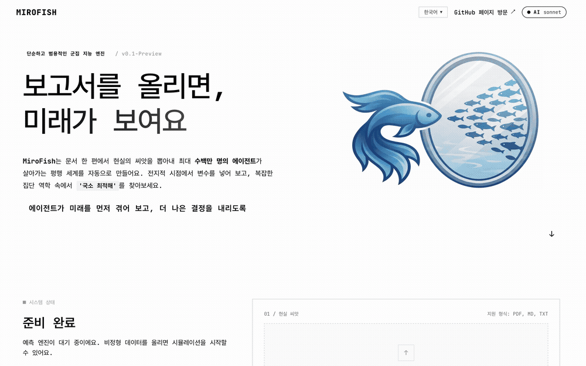
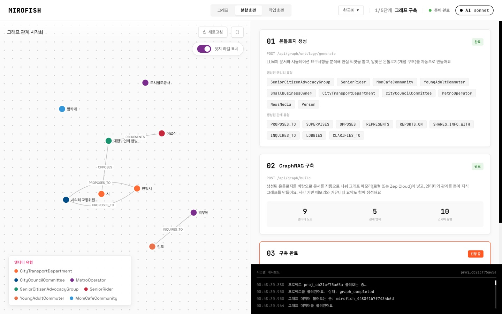
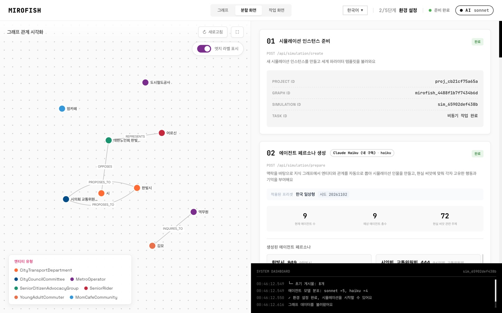
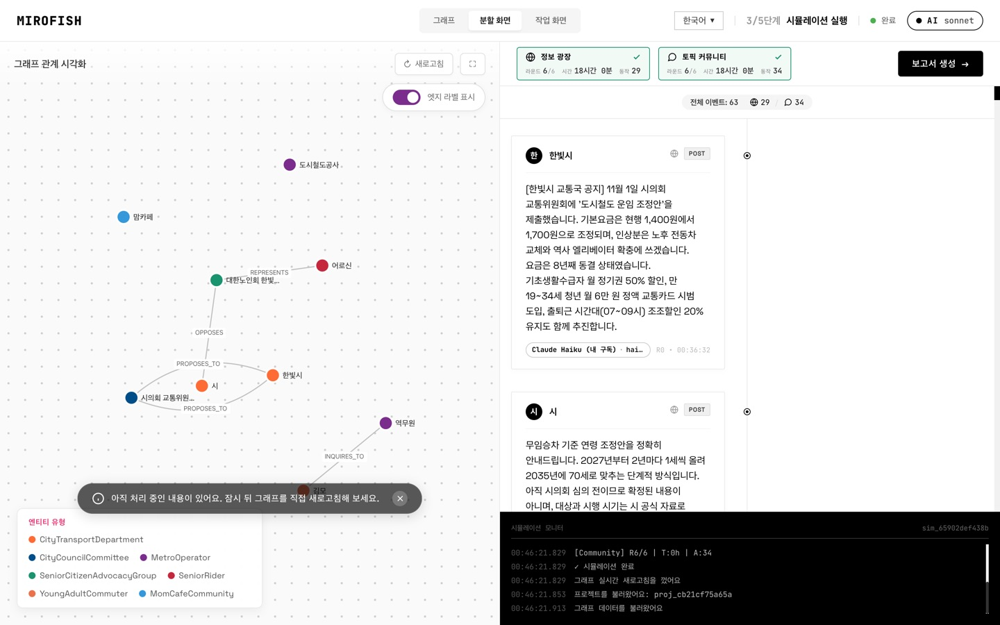
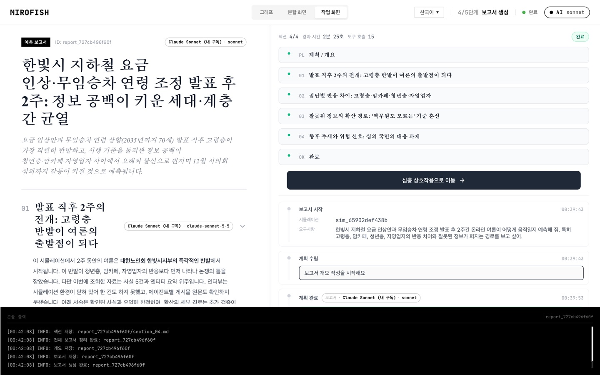
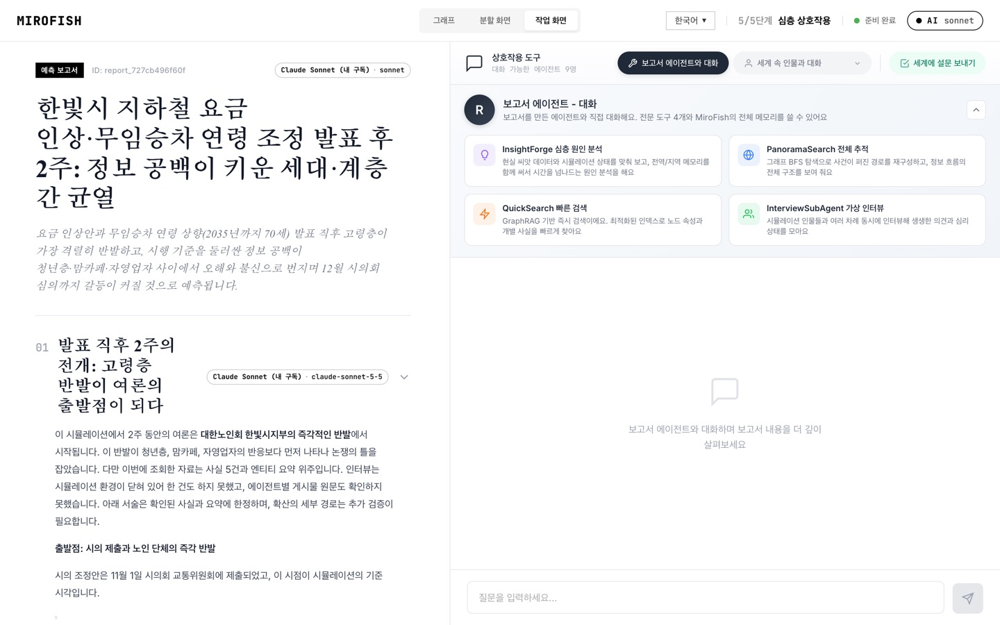
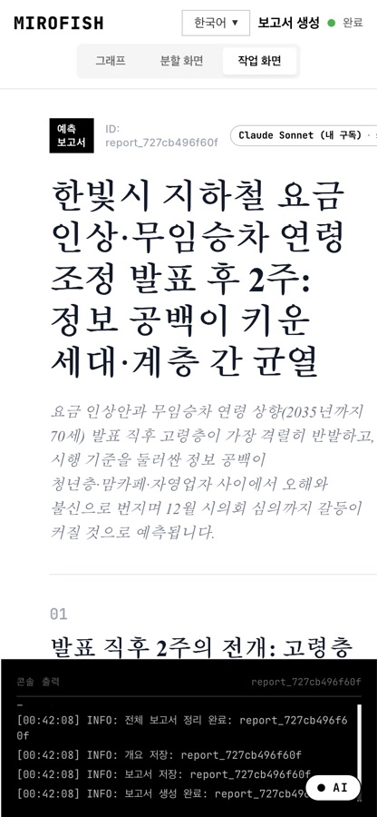
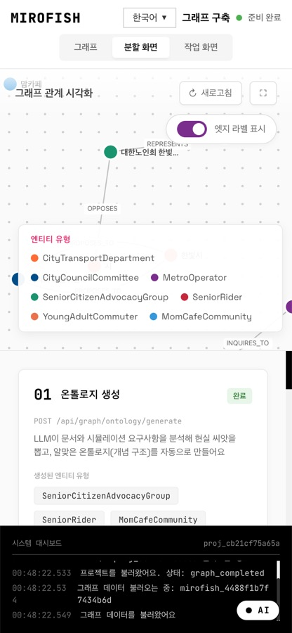

<div align="center">


간단하고 범용적인 군집 지능 엔진으로 무엇이든 예측해 보세요

**한국어** | [English](./README-EN.md) | [中文文档](./README-ZH.md)

</div>

## 개요

**MiroFish**는 여러 AI 에이전트가 함께 움직이는 예측 엔진이에요. 뉴스 기사, 정책 초안, 보고서 같은 현실의 자료를 올리면 그 내용으로 가상 세계를 만들고, 각자 성격과 기억이 있는 에이전트 수십~수백 명이 그 안에서 글을 쓰고 댓글을 달며 서로 영향을 주고받아요. 시뮬레이션이 끝나면 보고서 에이전트가 무슨 일이 일어났는지 정리하고, 원하는 에이전트와 직접 대화할 수도 있어요.

> **올릴 것**: 자료(보고서, 기사, 소설 등)와 "무엇을 예측하고 싶은지" 한 문장
> **받는 것**: 예측 보고서, 그리고 직접 들어가 볼 수 있는 가상 세계

## 원본과 무엇이 다른가요

이 저장소(`MiroFish-kr`)는 [666ghj/MiroFish](https://github.com/666ghj/MiroFish)의 포크예요. 원본은 커밋 `7657031` 기준이고, 숫자는 같은 컴퓨터에서 직접 잰 값이에요([측정 결과](./docs/PERFORMANCE-KR.md), [UX 개선 목록](./docs/UX-IMPROVEMENTS-KR.md)).

| 항목 | 원본 | MiroFish-kr |
|---|---|---|
| 화면 언어 | 중국어·영어. 처음 열면 중국어 | **한국어**·영어·중국어(세 언어 모두 번역 키 1,037개). 브라우저 언어를 보고 고르고, 없으면 영어 |
| AI 연결 | OpenAI 호환 API 키 하나 | API 키, **ChatGPT 로그인**, 이미 로그인된 **Claude Code·Cursor 공식 CLI** |
| 모델 구성 | 모든 단계·에이전트가 같은 모델 | 단계마다, 에이전트마다 다른 모델. 누가 어떤 모델로 움직였는지와 토큰·캐시 사용량을 화면에 표시 |
| 그래프 메모리 | Zep Cloud 계정 필수 | **무료 로컬 그래프**가 기본(한국어 2글자 검색 지원). Zep Cloud는 선택 |
| 프롬프트·페르소나 | 중국어 지시문, 국가·시간대(UTC+8)가 중국으로 고정 | 영어 지시문 + 출력 언어 지정. 언어별 지역 설정(한국이면 KST 출퇴근·점심·밤 패턴) |
| 인물 다양성 | 따로 조절할 수 없음 | 인물 유형 프리셋. 한국 일상형 11가지(계속 묻는 어르신, 길막형 방관자 등) |
| 처음 쓰는 흐름 | 단계마다 버튼을 직접 누르고, 지금 뭘 해야 하는지 안내가 없음 | **빠른 시험 / 실제 규모** 선택, **보고서까지 자동 진행**(끝나면 알림), 모든 화면 위에 "지금 할 일" 안내와 전체 진행 막대 |
| 걸리는 시간 | 진행률(%)만 표시. 시뮬레이션의 "시간"은 가상 시간 | 단계마다 지난 시간과 남은 시간, 시작 전 예상 시간·AI 호출 수. 실제 시간과 가상 시간을 따로 표시 |
| 보고서 | 라운드가 끝나도 인터뷰용 환경을 직접 닫기 전엔 만들 수 없음(실사용에서 35분 대기). 화면에 내려받기 버튼 없음 | 라운드와 그래프 반영이 끝나면 바로 생성. 제목으로 이름 붙은 Markdown 내려받기 |
| 중복 실행 | 화면을 다시 열거나 새로 고치면 실행·페르소나 생성이 다시 돌 수 있음(비용 발생) | 이미 돌고 있는 작업에 다시 연결하고, 같은 프로젝트에 새 시뮬레이션을 만들기 전에 물어봄 |
| 첫 화면 JS | 520 kB 한 덩어리(gzip 168 kB) | 359 kB(gzip 128 kB). 한국어 번역과 AI 패널을 포함하고도 31% 작음 |
| 시뮬레이션 화면 폴링 | 요청마다 전체 액션 3.17 MB, 186 ms | 새 액션만 73 kB, 1.8 ms |

## 빠른 시작

### 준비물

| 도구 | 버전 | 확인 |
|---|---|---|
| Node.js | 18 이상 | `node -v` |
| Python | 3.11 ~ 3.12 | `python --version` |
| uv | 최신 | `uv --version` |

### 1. 설치

```bash
npm run setup:all   # 루트·프런트(npm) + 백엔드(uv) 의존성을 한 번에 설치
```

### 2. AI 연결하기 (셋 중 하나만 있으면 돼요)

루트에 `.env` 파일을 만들어요(`.env.example`을 복사해서 시작하면 편해요).

**A. API 키** — OpenAI SDK와 호환되는 API면 무엇이든 돼요(OpenAI, DeepSeek, Qwen 등).

```env
LLM_API_KEY=키
LLM_BASE_URL=https://api.openai.com/v1
LLM_MODEL_NAME=gpt-4o-mini
```

**B. 구독으로 로그인** — API 키가 없어도 돼요. MiroFish는 로그인 정보를 저장하거나 읽지 않아요.

| 구독 | 방법 | 프로필 예시 (`LLM_PROFILES`) |
|---|---|---|
| ChatGPT Plus/Pro | 화면 오른쪽 위 **AI** → **ChatGPT로 계속하기** (OpenAI 공식 오픈소스 앱용 로그인) | `{"id":"chatgpt","label":"ChatGPT","kind":"chatgpt_oauth","model":"gpt-5"}` |
| Claude Pro/Max | 터미널에서 `claude` 실행 → `/login` (Anthropic 공식 Claude Code CLI) | `{"id":"claude","label":"Claude (내 구독)","kind":"claude_code_cli","model":"sonnet"}` |
| Cursor | 터미널에서 `agent login` (Cursor 공식 CLI) | `{"id":"cursor","label":"Cursor (내 구독)","kind":"cursor_agent_cli","model":"<agent models에서 확인>"}` |

```env
LLM_PROFILES=[{"id":"claude","label":"Claude (내 구독)","kind":"claude_code_cli","model":"sonnet"}]
```

> Claude·Cursor는 각 회사의 공식 CLI를 그대로 실행하는 방식이에요. Anthropic 정책상 서드파티 앱이 Claude 로그인 창을 띄우거나 토큰을 다루는 건 허용되지 않지만, 사용자가 수정하지 않은 Claude Code에 직접 로그인해 쓰는 건 허용돼요([정책](https://code.claude.com/docs/en/legal-and-compliance)). 구독 사용량은 "일반적인 개인 사용"을 기준으로 하니, 에이전트 수가 많으면 한도에 닿을 수 있어요. MiroFish는 동시 실행 수를 `CLI_MAX_CONCURRENCY`(기본 2)로 제한해요.

**C. 여러 모델 섞기 (멀티 provider)** — 단계별로, 그리고 에이전트별로 다른 모델을 배정해요.

```env
LLM_PROFILES=[{"id":"claude_sonnet","label":"Claude Sonnet","kind":"claude_code_cli","model":"sonnet"},{"id":"cheap","label":"DeepSeek","kind":"openai_compatible","model":"deepseek-chat","base_url":"https://api.deepseek.com/v1","api_key_env":"DEEPSEEK_API_KEY"}]
LLM_ROUTES={"report":"claude_sonnet","profile":"cheap","config":"cheap"}
LLM_AGENT_POOL={"claude_sonnet":1,"cheap":3}
```

- 단계: `ontology`, `profile`, `config`, `report`, `report_chat`, `interview`, `search_planning`, `simulation_agent`, `graph_extract`
- `LLM_AGENT_POOL`은 시뮬레이션 에이전트에게 모델을 비율대로 나눠 줘요. 같은 시뮬레이션 안에서 "Claude가 움직이는 사람"과 "DeepSeek이 움직이는 사람"이 섞이고, 보고서는 이 차이를 하나의 변수로 다뤄요.

### 3. 그래프 메모리 (무료가 기본)

아무것도 설정하지 않으면 **로컬 그래프**를 써요. 계정도 비용도 필요 없어요.

```env
GRAPH_BACKEND=local            # 기본값 (ZEP_API_KEY가 없을 때)
GRAPH_LOCAL_EMBEDDINGS=on      # 다국어 임베딩(intfloat/multilingual-e5-small, 최초 1회 내려받기). off면 키워드 검색만
# GRAPH_LOCAL_DB=backend/uploads/graph_local.db
```

Zep Cloud를 쓰고 싶으면 `ZEP_API_KEY`만 넣으면 돼요.

### 4. 실행

```bash
npm run dev   # 백엔드(:5001) + 프런트(:3000)를 함께 실행
```

브라우저에서 `http://localhost:3000`을 열어요. 처음이라면 홈에서 **빠른 시험**을 고르고 **보고서까지 알아서 진행**을 켠 채 시작해 보세요. 10라운드 기준 20~30분이면 보고서까지 끝나고, 그동안 화면 위 안내 띠가 지금 무엇을 하는 중인지 알려 줘요. 오른쪽 위 **AI** 버튼에서 지금 연결된 모델, 단계별 모델, 토큰 사용량(캐시 적중 포함)을 볼 수 있어요.

### 5. 터미널에서 쓰기 (CLI)

웹 화면 없이 터미널에서도 실행하고, 지켜보고, 정보를 확인할 수 있어요. CLI는 화면과 같은 API를 쓰기 때문에 화면에서 시작한 실행을 CLI로 보거나, 그 반대도 돼요.

```bash
cd backend
uv run mirofish serve                      # 백엔드만 실행 (npm run dev 대신)
uv run mirofish status                     # 서버·그래프 백엔드·AI 모델 연결 상태

# 문서를 올려서 보고서까지 한 번에 (기본은 빠른 시험 10라운드)
uv run mirofish run 자료.md -p "발표 후 2주 동안 여론이 어떻게 움직일지 예측해 줘" -o reports/
uv run mirofish run 자료.md -p "..." --full          # 자동으로 정한 라운드 수 그대로
uv run mirofish run 자료.md -p "..." --rounds 48     # 라운드 수 지정

uv run mirofish watch sim_xxxx             # 진행 상황 실시간 보기 (proj_/sim_/report_ 모두 가능)
uv run mirofish list sims                  # projects / sims / reports
uv run mirofish show report_xxxx           # 자세히 보기
uv run mirofish estimate sim_xxxx --rounds 48   # 시작 전 시간·AI 호출 예상
uv run mirofish start sim_xxxx --rounds 10 -f   # 준비된 시뮬레이션 시작하고 따라 보기
uv run mirofish stop sim_xxxx
uv run mirofish report generate sim_xxxx   # 보고서 만들기
uv run mirofish report download report_xxxx -o reports/
uv run mirofish chat sim_xxxx "고령층 반응을 요약해 줘"   # 보고서 에이전트에게 질문
uv run mirofish usage                      # 단계·모델별 토큰 사용량
```

- 루트에서는 `npm run cli -- status`처럼 써도 돼요.
- `--json`을 붙이면 결과를 JSON으로 출력해서 스크립트에서 쓰기 좋아요.
- `--lang ko|en|zh`로 출력 언어를 고를 수 있어요. 지정하지 않으면 `MIROFISH_LANG`, `LANG` 순서로 정해요.
- 서버 주소가 다르면 `--api http://서버:5001` 또는 `MIROFISH_API`를 써요.
- `run`이나 `watch` 중에 Ctrl+C를 눌러도 작업은 서버에서 계속 돌아요. 나중에 `mirofish watch <ID>`로 다시 보면 돼요.

## 한국형 인물 유형 (페르소나 변수)

환경 설정 단계에서 **인물 유형 구성**을 고르면 에이전트에게 행동 특성이 섞여 들어가요. 같은 사건이라도 누가 어떻게 반응하고, 정보가 어디서 막히고 어디서 퍼지는지가 달라져요.

| 유형 | 행동 특징 |
|---|---|
| 계속 묻는 디지털 소외 어르신 | 같은 질문을 되풀이하고, 전달받은 메시지를 쉽게 믿어요 |
| 동네 아줌마·맘카페 네트워커 | 지역 정보와 입소문을 빠르게 퍼뜨려요 |
| 길막형 수동 방관자 | 누가 설명해 주기 전까지 움직이지 않아요 |
| 단톡방 정보 전달자 | 확인 없이 링크와 캡처를 빠르게 퍼날라요 |
| 악플러·어그로꾼 | 일부러 자극적으로 반응해요 |
| 눈팅족 | 읽기만 하고 거의 글을 쓰지 않아요 |
| 커뮤니티 고인물 | 예전 글을 들추고 텃세를 부려요 |
| 바쁜 직장인 | 출퇴근·점심·밤 시간에 몰아서 반응해요 |
| 취준생·대학생 | 취업 불안, 밈 위주로 반응해요 |
| 자영업 사장님 | 비용과 정책 변화에 민감하고 실용적이에요 |
| 깐깐한 팩트체커 | 출처를 묻고 틀린 정보를 바로잡아요 |

프리셋: `ko_everyday`(한국), `en_everyday`(영어권), `zh_everyday`(중국어권), `mixed_global`(섞어서), `off`. 한국 프리셋을 고르면 활동 시간도 한국 생활 패턴(출근 7~9시, 점심 12~13시, 퇴근 18~20시, 밤 21~24시)을 따라요.

## 데모 시나리오: 한빛시 지하철 요금 인상

`docs/demo/ko/seed-subway-fare.md`는 데모용 **가상** 보도자료예요. 한빛시가 지하철 기본요금 인상과 무임승차 연령 조정을 발표한 상황에서 고령층, 맘카페, 청년, 자영업자가 어떻게 반응하는지 시험해요.

아래는 이 시나리오를 2026년 11월 2일에 **실제로 한 번 돌린 결과**예요. LLM은 Claude 구독(공식 Claude Code CLI, Sonnet·Haiku 두 프로필), 그래프는 무료 로컬 백엔드를 썼어요. 비용을 아끼려고 에이전트 9명, 6라운드로 작게 돌렸어요.

<div align="center">

</div>

| 1. 그래프 구축 | 2. 환경 설정 (인물 유형·모델 배정) |
|---|---|
|  |  |
| **3. 시뮬레이션** (게시물마다 움직인 모델 표시) | **4. 예측 보고서** |
|  |  |
| **5. 보고서 에이전트와 대화** | **모바일 (390px)** |
|  |   |

**이번 실행에서 실제로 나온 것**

- 에이전트 9명에게 인물 유형 9가지(단톡방 정보 전달자, 눈팅족, 커뮤니티 고인물, 계속 묻는 디지털 소외 어르신, 깐깐한 팩트체커, 자영업 사장님, 바쁜 직장인, 취준생·대학생, 맘카페 네트워커)가 하나씩, 모델은 Sonnet 5명 / Haiku 4명으로 나뉘었어요.
- 6라운드 동안 게시물·댓글·공유 등 63건이 생겼어요. 예를 들면:
  - 맘카페: "지하철 무임 기준이 바뀌면 65세 넘은 분들도 바로 유료로 바뀐다던데 사실인지 궁금합니다." → 이후 스스로 "확정된 내용은 아니에요"라고 정정
  - 어르신: "70세로 바뀐다는 게 나도 해당되는 건지 아무도 설명을 안 해줍니다. 역무원한테 물어봐도 모른다고만 합니다."
  - 시: "모든 분께 한꺼번에 적용되는 것이 아니며, 출생 연도와 시행 시기에 따라…" 같은 해명 글
- 보고서 제목은 **"한빛시 지하철 요금 인상·무임승차 연령 조정 발표 후 2주: 정보 공백이 키운 세대·계층 간 균열"**, 4개 섹션, 도구 호출 15번, 2분 25초가 걸렸어요. 본문에 한자는 한 글자도 없었어요.
- 보고서 대화에 "고령층에서 잘못된 정보가 퍼진 경로를 요약해 줘"라고 묻자, 시뮬레이션에서 확인된 것("역무원도 모른다")과 추론을 나눠서 답했어요.

**토큰 사용량 (AI 패널의 사용량 표와 같은 값)**

| 단계 | 호출 | 입력 토큰 | 그중 캐시 | 출력 토큰 |
|---|---:|---:|---:|---:|
| 온톨로지 | 1 | 25,609 | 12,192 (48%) | 2,965 |
| 페르소나 생성 | 20 | 1,010,583 | 561,202 (56%) | 114,512 |
| 시뮬레이션 설정 | 6 | 252,798 | 155,141 (61%) | 25,405 |
| 시뮬레이션 에이전트 | 22 | 633,815 | 198,590 (31%) | 17,996 |
| 보고서 | 11 | 382,094 | 131,030 (34%) | 15,391 |
| 보고서 대화 | 3 | 107,329 | 53,074 (49%) | 2,678 |

> Claude Code CLI는 호출마다 자체 기본 컨텍스트(약 2만 토큰)를 붙여서, 짧은 요청도 입력 토큰이 커 보여요. 대부분 캐시에서 읽히지만 구독 사용량에는 잡혀요. 에이전트 수가 많은 실험에는 API 키 프로필(DeepSeek, OpenAI 등)을 `LLM_AGENT_POOL`에 섞는 쪽이 효율적이에요.

## 더 읽을거리

- [UX 개선 목록(근거·전후 비교)](./docs/UX-IMPROVEMENTS-KR.md)
- [성능 측정(CPU·메모리·디스크 전후)](./docs/PERFORMANCE-KR.md)
- [번역 용어집](./locales/GLOSSARY.md)

## 감사의 말

MiroFish는 [OASIS](https://github.com/camel-ai/oasis)(CAMEL-AI) 시뮬레이션 엔진을 기반으로 만들어졌어요. 원본 프로젝트는 [666ghj/MiroFish](https://github.com/666ghj/MiroFish)이고, 라이선스는 AGPL-3.0이에요.
