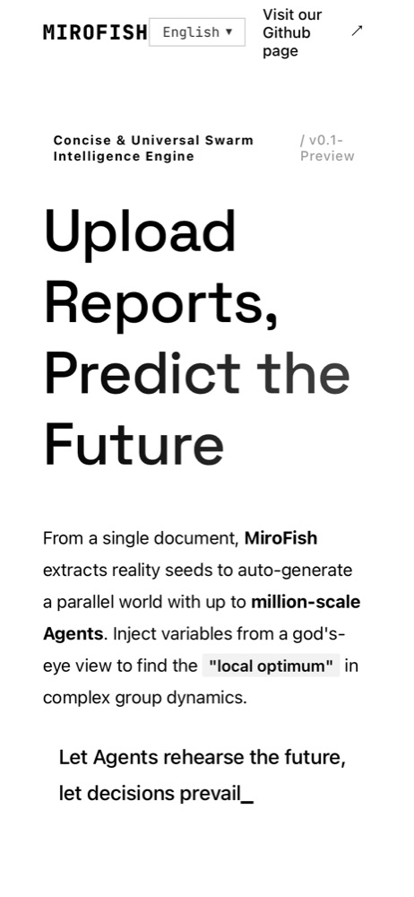
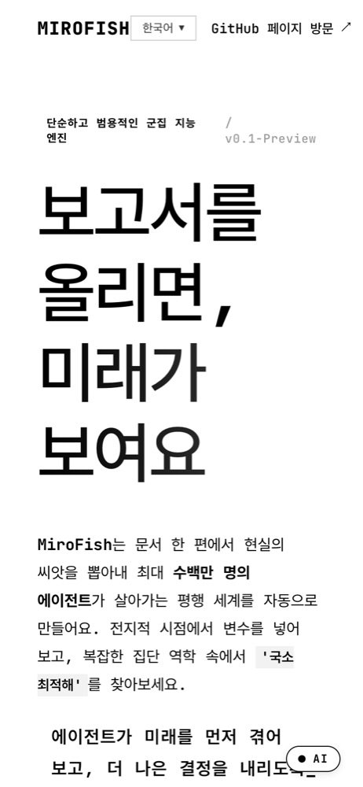
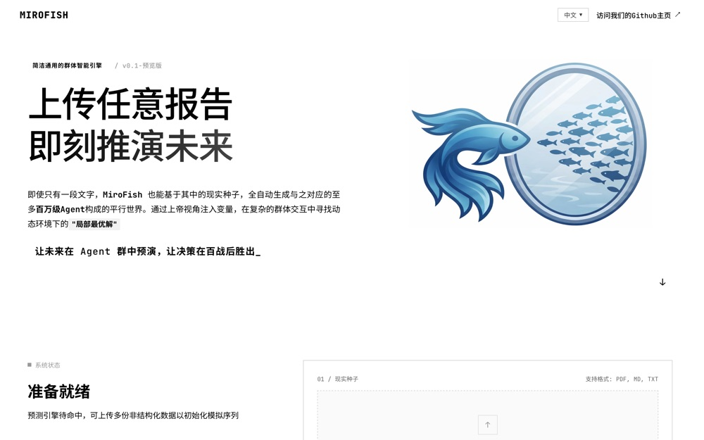
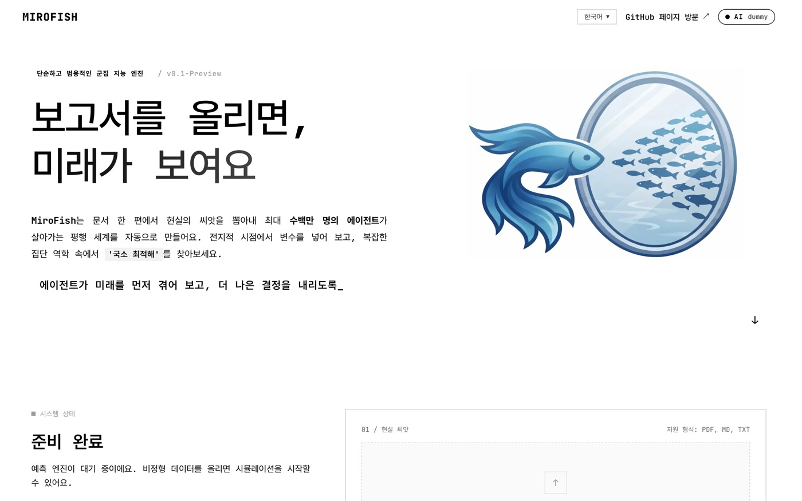
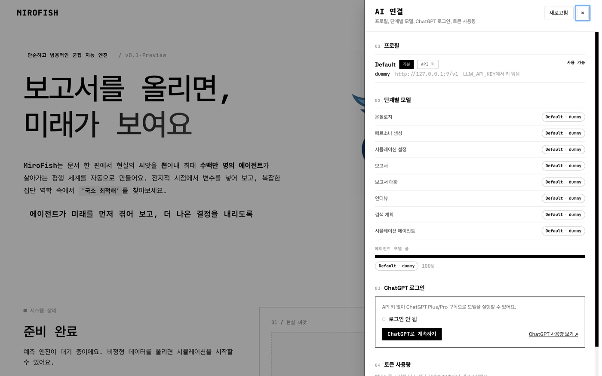

# MiroFish UX 개선 목록 (한국어 사용자 기준)

> 기준 시점: 개선 전 = `ceb8e32`(main `7657031`과 같은 코드), 개선 후 = `feat/korean-multiprovider` 브랜치.
> 근거는 파일:줄, 측정값, 스크린샷 경로로 적었습니다. **상태**는 `완료(검증됨: 근거 종류)`, `부분 완료`, `제안`(이번 브랜치에서 고치지 않음)으로 구분합니다. "실행 QA"는 2026-11-02에 한국어 데모 시나리오를 실제로 끝까지 돌리며 확인한 것을 뜻합니다(README 데모 섹션).

## 요약

| # | 문제 | 누가 겪나 | 개선 후 | 상태 |
|---|---|---|---|---|
| 1 | 처음 열면 중국어 화면 | 한국어·영어 사용자 전원 | 브라우저 언어 자동 선택, 없으면 영어 | 완료(검증됨, 테스트) |
| 2 | 한국어 UI 없음 | 한국어 사용자 | 한국어 키 전체 번역(zh/en과 키 수 동일) | 완료(검증됨: 화면 7개 한자 0자) |
| 3 | 모바일 헤더 링크가 세 줄로 접힘 | 모바일 사용자 | 한 줄로 표시 | 완료(검증됨, 스크린샷) |
| 3b | 한국어 문단이 양쪽 정렬로 단어 사이가 벌어짐(QA에서 발견) | 한국어 사용자 | 한국어일 때 왼쪽 정렬 | 완료(검증됨, 스크린샷) |
| 4 | API 키 없으면 시작 불가 | 구독자 | ChatGPT 로그인(공식 OSS 경로), Claude Code·Cursor 공식 CLI | 부분 완료: Claude CLI는 실행 QA로 검증됨, ChatGPT는 가짜 인증 서버 테스트만(실계정 미검증), Cursor는 로그인 전이라 실호출 미검증 |
| 5 | 어떤 AI가 무슨 일을 하는지 안 보임 | 전원 | 단계별·에이전트별 모델 배지, AI 연결 패널 | 완료(검증됨: 실행 QA 스크린샷) |
| 6 | 토큰·캐시 사용량을 알 수 없음 | 비용 민감 사용자 | AI 연결 패널의 사용량 표(단계·모델별, 캐시 포함) | 완료(검증됨: 실행 QA `/api/llm/usage`) |
| 7 | 시뮬레이션 화면이 오래 켜 두면 무거워짐 | 긴 시뮬레이션 사용자 | 새 액션만 받아오고 최신 500개만 표시 | 완료(검증됨: 응답 3.17 MB→73 kB 측정, 속성 테스트) |
| 8 | 그래프가 바뀐 게 없어도 10초마다 다시 그려짐 | 그래프 구축 중 사용자 | 바뀌었을 때만 다시 그림(ETag/304) | 완료(ETag는 테스트로 검증, 화면 재그리기 생략은 코드 검토만) |
| 9 | 첫 화면 로딩이 무거움 | 전원, 특히 모바일 | 한국어 첫 화면에서 받는 JS 520,165 B → 358,705 B(gzip 168,420 → 127,522 B, -24%), 로고 webp | 완료(검증됨: 빌드본을 띄워 첫 화면이 실제로 불러온 청크 합산) |
| 10 | 페르소나가 중국 기준(국가·시간대) | 한국어·영어 사용자 | 언어별 지역 프로필(한국: KST 생활 패턴) | 완료(검증됨: 실행 QA 설정 근거 "한국 표준시(Asia/Seoul) 기준") |
| 11 | 인물 다양성을 조절할 수 없음 | 연구자 | 인물 유형 프리셋 선택(한국 일상 등) | 완료(검증됨: 실행 QA에서 9명에게 9개 유형 배정) |
| 12 | 서버 메시지가 중국어로 뜸 | 한국어·영어 사용자 | 요청 언어로 표시 | 완료(검증됨: 진행 메시지·콘솔 로그 한국어, 화면 한자 0자). 서버 내부 로그·주석은 중국어 그대로 |
| 13 | 날짜가 en-US/zh-CN으로 고정 | 전원 | 현재 언어 형식(`Intl.DateTimeFormat`) | 완료(코드·빌드 확인) |
| 14 | Docker가 개발 서버로 실행됨 | 배포 사용자 | 빌드된 정적 파일 제공 | 제안 |
| 15 | 보고서 마크다운이 이스케이프 없이 `v-html`로 렌더링됨 | 전원(보안) | sanitize 후 렌더링 | 제안 |
| 16 | 업로드·로그·DB가 무기한 쌓임 | 장기 사용자 | 보존 기간 설정과 정리 버튼 | 제안 |
| 17 | 실행 전에 비용을 가늠할 수 없음 | 비용 민감 사용자 | 라운드×에이전트 기준 예상 표시 | 완료(29번으로 구현) |
| 18 | 키 설정이 `.env` 직접 편집뿐 | 비개발자 | 설정 화면에서 프로필 추가 | 제안 |
| 19 | 시뮬레이션 화면을 다시 열거나 새로고침하면 이미 끝난 실행이 처음부터 다시 돈다(비용 발생). 실행 QA에서 발견 | 전원 | 기존 실행이 있으면 결과를 이어서 보여 주고, 처음일 때만 시작 | 완료(검증됨: 화면 7번 재진입 동안 `POST /api/simulation/start` 증가 0건) |
| 20 | 라운드 수를 줄여 짧게 돌리면 밤 0~5시만 시뮬레이션돼 아무 일도 안 일어남(5라운드에 액션 8개). 실행 QA에서 발견 | 비용을 아끼려는 사용자 | 짧은 실행은 피크 시간(없으면 아침·업무 시간)에서 시작, `time_config.start_hour`로 지정 가능 | 완료(검증됨: 6라운드 액션 63개, 테스트 4개) |
| 21 | 모바일에서 작업 화면 헤더가 겹치고 분할 화면이 두 열로 좁게 나뉨 | 모바일 사용자 | 헤더 줄바꿈, 분할 화면은 위아래로 쌓기 | 완료(검증됨: 390px 스크린샷) |
| 22 | 직역투 탭 이름 "분할 / 작업대", "Step 1/5" 미번역, "Report Agent" 영어 혼용 | 한국어 사용자 | "분할 화면 / 작업 화면", "1/5단계", "보고서 에이전트" | 완료(검증됨: 스크린샷) |
| 23 | 그래프 단계 설명이 "Zep에 보낸다"고 안내(무료 로컬 모드에서는 사실이 아님) | 전원 | "그래프 메모리(로컬 또는 Zep Cloud)" | 완료(검증됨: 스크린샷, zh/en/ko) |
| 24 | 엔티티 유형이 `CityTransportDepartment`처럼 영어 식별자로만 보임 | 한국어 사용자 | 온톨로지에 현지화된 표시 이름 필드를 두고 범례에 사용 | 제안 |
| 25 | 그래프 구축이 끝났는데 "03 구축 완료" 카드에 "진행 중" 배지 | 전원 | 완료 상태 배지 | 제안(실행 QA에서 관찰, 미수정) |
| 26 | 모바일에서 떠 있는 "AI" 버튼이 맨 아래 문구·로그와 겹침 | 모바일 사용자 | 헤더 안으로 옮기거나 하단 여백 확보 | 제안 |
| 27 | 프런트 `getReportStatus`는 GET, 백엔드는 POST만 받음(개선 전부터) | 개발자 | 한쪽으로 맞추기. 화면에서는 쓰지 않는 함수라 사용자 영향은 없음 | 제안 |
| 28 | 얼마나 걸리는지 안 보임(테스트 런 피드백) | 전원 | 그래프·준비·시뮬레이션·보고서 단계마다 실제 지난 시간과 남은 시간. 남은 시간은 실제로 세는 값(처리한 조각 비율, 생성한 페르소나 수, 라운드, 섹션)이 20초 이상 움직인 뒤에만 표시 | 완료(검증됨: `docs/images/ux/after-graph-timer-ko.jpg`, `after-sim-real-time-ko.jpg`. 보고서 단계는 화면 기록으로 확인: 섹션 2/4에서 "약 6분 남음" → 실제 약 6분 45초 뒤 완료, 이후 5분·4분·3분·2분·1분 순으로 줄어듦. "마무리하는 중"은 마지막 섹션과 완료가 동시에 와서 화면에서 보지 못함) |
| 29 | 시작 전에 시간·비용을 알 수 없음 | 비용 민감 사용자 | 시작 버튼 위 "시작 전 예상": 이 컴퓨터의 지난 실행 기록으로 시간, 설정 활동량으로 AI 호출 횟수(토큰 기록이 있으면 토큰) | 완료(검증됨: 48라운드 예상 784초 vs 실제 812초, 10라운드 예상 163초 vs 실제 144초, `after-start-estimate-ko.jpg`) |
| 30 | 시뮬레이션의 "시간"이 실제 시간인지 가상 시간인지 헷갈림 | 전원 | 플랫폼 칸은 "가상 시간", 위쪽 막대는 "실제 시간"으로 분리 | 완료(검증됨: `after-sim-real-time-ko.jpg`) |
| 31 | 보고서를 내려받을 수 없음 | 전원 | 보고서 화면 "보고서 내려받기 (Markdown)" 버튼, 파일 이름은 `제목_날짜.md` | 완료(검증됨: 응답 `filename*=UTF-8''Bop(밥)의_…_2026-11-02.md`, 23,664 B, `after-report-download-ko.jpg`) |
| 32 | 라운드가 끝나도 인터뷰용 환경을 닫기 전까지 보고서를 만들 수 없음(테스트 런에서 35분 대기) | 전원 | 마지막 라운드 직후 그래프 메모리를 비우고, 환경이 열려 있어도 보고서 생성 허용(보고서 에이전트가 인터뷰도 가능) | 완료(검증됨: 반영 완료 12:18:32와 같은 초에 보고서 자동 시작, 테스트 4개) |
| 33 | 같은 프로젝트에서 "환경 설정으로 이동"을 다시 누르면 시뮬레이션이 하나 더 생겨 조용히 돈다(테스트 런에서 72라운드 실행이 의도치 않게 추가됨) | 전원 | 기존 시뮬레이션이 있으면 만든 시각을 보여 주고 이어 볼지 묻기 | 완료(검증됨: 확인 시 새 생성 없이 기존 실행 화면으로 이동) |
| 34 | 준비 중에 새로 고침하면 페르소나 생성이 처음부터 다시 돈다(실행 QA에서 발견, 3번 겹쳐 실행됨) | 전원 | 같은 시뮬레이션의 준비 작업이 돌고 있으면 그 작업에 다시 연결 | 완료(검증됨: 일부러 새로 고친 실행에서 생성 시작 1회, 테스트 1개) |
| 35 | 로컬 그래프인데 진행 메시지가 "Zep 처리 중" | 전원 | "그래프 만드는 중… n/N개 완료" 등 백엔드 이름 없는 문구 10개(zh/en/ko) | 완료(검증됨: 실행 QA 콘솔 로그) |
| 36 | 그래프 그림이 진행률과 따로 10초마다 갱신되고, 빈 패널은 그래프 단계에서도 "온톨로지 생성을 기다리는 중" | 그래프 구축 중 사용자 | 진행률이 바뀔 때마다 그래프 재요청(변화 없으면 304), 빈 패널 문구를 단계별로 | 완료(검증됨: 빈 패널 문구 `after-graph-timer-ko.jpg`. 진행률 변화 시 재요청은 코드 확인) |
| 37 | 무엇을 해야 하는지 모름(테스트 런 피드백) | 처음 쓰는 사람 | 모든 단계 위 안내 띠: "전체 n/5단계"와 그 아래 전체 진행 막대, "기다리는 중/할 일/문제 발생", 지금 누를 버튼 이름 | 완료(검증됨: 5개 화면 모두 확인, 진행 막대 4/5단계 80%·5/5단계 100%, `after-progress-bar-ko.jpg`) |
| 38 | 처음부터 규모를 정하기 어려움 | 처음 쓰는 사람 | 홈에서 "빠른 시험(10라운드)" / "실제 규모" 선택 | 완료(검증됨: `after-run-mode-ko.jpg`, `after-run-mode-mobile-ko.jpg`) |
| 39 | 단계마다 버튼을 직접 눌러야 하고 끝났는지 계속 확인해야 함 | 전원 | "보고서까지 알아서 진행" 켜면 각 단계 버튼을 자동으로 누르고 끝나면 브라우저 알림. 비용이 드는 단계는 화면을 다시 열어도 한 번만 실행 | 완료(검증됨: 업로드 후 사람 개입 없이 25분 7초 만에 보고서 완성, `after-auto-run-done-ko.jpg`. 화면 안 완료 안내는 확인, 브라우저 알림은 헤드리스 브라우저에서 권한을 줄 수 없어 미확인) |
| 40 | 라운드가 끝난 뒤 그래프 반영(로컬 그래프 기준 6분 26초) 동안 화면에 설명이 없고 "1분 안에 끝나요"가 계속 보임 | 그래프 메모리 갱신을 켠 사용자 | 안내 띠와 실제 시간 막대에 "라운드는 끝났고, 그래프 메모리에 반영하는 중 (남은 N건)". 보고서는 "마무리하는 중" | 완료(검증됨: `after-ingest-wait-ko.jpg`, `graph_ingest_pending` 11→5→3 감소) |
| 41 | 시뮬레이션 화면 헤더 상태가 한국어에서도 "Running"(하드코딩) | 한국어·중국어 사용자 | `common.statusRunning` 번역 키 | 완료(검증됨: `after-ingest-wait-ko.jpg` 헤더 "실행 중") |
| 42 | 시뮬레이션 화면을 실행 직후(0라운드)에 열면 화면이 `force: true`로 다시 시작해 진행 중 실행을 죽이고 기본 라운드로 새로 돈다(검증 중 3라운드 요청이 168라운드로 바뀜, 40라운드에서 중지). 1차 작업의 재방문 수정에 남아 있던 빈틈 | 전원 | 진행 중 상태(`starting`/`running`/`paused`/`stopping`)는 라운드와 무관하게 기존 실행으로 보고 이어서 표시 | 완료(검증됨: 재검증에서 시작 요청 1회, 3라운드 유지) |
| 43 | 라운드 직후 그래프 반영 중에 "중지"를 누르면 반영이 끝날 때까지 응답이 없고(60초 넘게 무응답), 그사이 서버가 꺼지면 상태가 `stopping`으로 영구히 남아 다시 시작할 수 없음 | 전원 | 반영 작업은 "내가 맡았다" 표시만 잠금 안에서 하고 실제 반영은 잠금 밖에서 진행. 화면의 중지 요청은 최대 10초만 기다린 뒤 202("중지 중")로 응답(서버 종료 정리는 기존처럼 끝까지 기다림). 서버 시작 시 프로세스가 사라진 진행 중 실행을 `stopped`로 정리 | 완료(검증됨: 반영 9건 대기 중 중지 → 20초 만에 202, 240초 뒤 `stopped`. 서버 재시작 시 `sim_4ca566589082` 정리 후 재시작 성공. 테스트 2개) |

## 상세

### 1. 처음 열면 중국어 화면
- **개선 전**: 저장된 언어가 없으면 `zh`로 시작합니다(`frontend/src/i18n/index.js:4-22`, `frontend/index.html:2-4`). 서버도 `Accept-Language`가 정확히 일치하지 않으면 중국어로 답했습니다(`backend/app/utils/locale.py:28-33`). `ko-KR`처럼 지역이 붙은 값은 일치하지 않아 한국 브라우저도 중국어를 받았습니다.
- **개선 후**: 프런트는 `navigator.languages`에서 지원 언어를 고르고, 서버는 RFC 9110 방식(q 값, `ko-KR`→`ko`)으로 고르며, 맞는 언어가 없으면 영어로 답합니다.
- **근거**: `backend/tests/test_locale_negotiation.py`(생성 헤더 2,000개 이상 속성 테스트).

### 2. 한국어 UI 없음
- **개선 전**: `locales/languages.json`에 7개 언어가 있지만 실제 파일은 `zh.json`, `en.json`뿐이고 한국어는 없었습니다.
- **개선 후**: `locales/ko.json` 631개 키, 해요체 메시지와 명사형 버튼 문구, 용어집 `locales/GLOSSARY.md`.
- **근거**: 키 정합성 스크립트 결과 zh/en/ko 631/631/631, 빠진 키 0, 자리표시자 불일치 0, 한글 비율 99.5%.

### 3. 모바일 헤더 링크가 세 줄로 접힘 / 3b. 한국어 문단 간격
- **개선 전**: 390px 폭에서 "Visit our Github page"가 세 줄로 접혀 로고·언어 선택과 겹쳐 보입니다.
- **개선 후**: "GitHub 페이지 방문"이 한 줄로 나옵니다. QA 중에 소개 문단이 `text-align: justify`라 한국어 단어 사이가 크게 벌어지는 문제를 찾아, 한국어에서는 왼쪽 정렬로 바꿨습니다(`frontend/src/views/Home.vue`, `:lang(ko) .hero-desc`).
- **남은 점**: 모바일에서 떠 있는 "AI" 버튼이 화면 맨 아래 문구와 살짝 겹칩니다(제안).

| 개선 전 (390px, 기존 영어 화면) | 개선 후 (390px, 한국어) |
|---|---|
|  |  |

| 개선 전 (처음 열면 중국어) | 개선 후 (브라우저 언어 한국어) |
|---|---|
|  |  |

### 4. API 키 없으면 시작 불가
- **개선 전**: `LLM_API_KEY`가 없으면 서버가 시작되지 않습니다(`backend/run.py`의 `Config.validate()`).
- **개선 후**: OpenAI 공식 "Sign in with ChatGPT" 오픈소스 앱 경로로 로그인하면 구독 요금제로 추론합니다(PKCE, `127.0.0.1` 콜백, `/v1/responses`). Claude·Gemini 구독 OAuth는 각 회사 약관이 서드파티 사용을 금지해서 넣지 않았고, API 키로 연결합니다.

### 5~6. 모델·사용량이 안 보임
- **개선 전**: 모델 이름은 시뮬레이션 설정 요약의 `llm_model` 하나만 응답에 있었고 화면에는 표시되지 않았습니다(`backend/app/api/simulation.py:1284-1292`, `Step2EnvSetup.vue`). 토큰 사용량 기록은 없었습니다.
- **개선 후**: `/api/llm/status`, `/api/llm/usage`, 헤더의 AI 연결 패널(프로필, 단계 8개별 모델, 에이전트 모델 풀 비율, ChatGPT 로그인, 토큰 사용량), 단계별 `ModelBadge`, 에이전트별 모델 표시.

### 7. 시뮬레이션 화면이 점점 무거워짐
- **개선 전**: 3초마다 전체 액션 기록을 받아오고, 브라우저는 받은 액션을 끝없이 쌓습니다(`Step3Simulation.vue:473-485,575-602`, `api/simulation.py:1976-2008`).
- **개선 후**: `after=<cursor>`로 새 액션만 받고, 화면에는 최신 500개만 둡니다. 전후 바이트는 `docs/PERFORMANCE-KR.md`에 적습니다.

### 8. 그래프 반복 재그리기
- **개선 전**: 그래프 객체가 바뀌면 SVG 전체를 지우고 force 시뮬레이션을 다시 시작하며, 구축 중에는 10초마다 전체 그래프를 다시 받습니다(`GraphPanel.vue:328-350`, `MainView.vue:306-328`).
- **개선 후**: `ETag`/304로 변경이 없으면 받지 않고, 변경이 없으면 다시 그리지 않습니다.

### 9. 첫 화면 로딩
- **개선 전**: JS 한 덩어리 520.17 kB(gzip 168.42 kB), 로고 jpeg 600.90 kB(개선 전 커밋 `ceb8e32`의 `npx vite build` 출력).
- **개선 후**: 라우트별 분할, 언어 파일은 현재 언어와 영어(대체 언어)만 불러오고, AI 연결 패널은 비동기 청크로 분리. 한국어 사용자가 홈 화면에서 받는 JS는 10개 청크 358,705 B(gzip 127,522 B)입니다. 개선 전에는 한국어도 AI 패널도 없는 상태로 520,165 B(gzip 168,420 B) 한 덩어리였습니다. 로고는 webp로 바꿨습니다.
- **측정 방법**: `vite preview`로 빌드본을 띄우고 브라우저가 불러온 JS 파일 목록을 얻은 뒤, 해당 파일 크기와 gzip 크기를 합산했습니다.

### 10~11. 중국 중심 페르소나와 고정된 인물 구성
- **개선 전**: 페르소나 프롬프트가 국가를 중국어로 쓰도록 요구하고, 규칙 기반 기관 프로필은 국가를 "中国"으로 고정했습니다(`oasis_profile_generator.py:758,807,861-873`). 활동 시간 기본값은 `CHINA_TIMEZONE_CONFIG`(UTC+8)였습니다(`simulation_config_generator.py:29-47`).
- **개선 후**: 언어별 지역 프로필(한국: 출근 7-9시, 점심 12-13시, 퇴근 18-20시, 밤 21-24시 피크)과 인물 유형 라이브러리(`backend/app/data/archetypes/ko.json`: 계속 묻는 디지털 소외 어르신, 동네 아줌마·맘카페 네트워커, 길막형 수동 방관자 등).

### 28~41. 첫 실제 사용(bop 테스트 런)에서 나온 불편

사용자가 bop 저장소 자료로 48라운드·72라운드 실행을 해 보고 남긴 피드백은 네 가지였습니다: 시간이 안 보임, 보고서를 못 받음, 그래프와 옆 화면 속도가 안 맞아 기다림, 무엇을 해야 할지 모름. 원인과 근거는 아래와 같습니다.

- **기다림의 실제 원인**: 테스트 런에서 가장 길게 기다린 구간은 그래프 그림이 아니라 보고서 차단이었습니다. 라운드가 09:12에 끝났지만 시뮬레이션 프로세스가 인터뷰를 받으려고 계속 떠 있어서 상태가 `running`으로 남았고, 보고서 API는 "끝난 실행"만 받았습니다(`backend/app/api/report.py`). 환경을 직접 닫은 10:07까지 약 55분, 그래프 반영이 끝난 뒤로 따지면 약 35분이 낭비됐습니다. 지금은 모든 플랫폼이 `simulation_end`를 남기면 러너가 그래프 메모리를 비우고(`SimulationRunner._drain_graph_memory_after_rounds`, 기존 마무리와 같은 잠금으로 `graph.add` 재전송 없음), 그 뒤 `rounds_finished`가 참이 되어 보고서를 만들 수 있습니다.
- **재실행 QA(2026-11-02 12:05~)**: 홈에서 데모 시나리오를 올리고 "빠른 시험 + 자동 진행"으로 시작했습니다. 그래프 구축(12:06:39) → 시뮬레이션 생성·준비(12:07:55) → 시작(12:09:42) → 10라운드 종료(12:12:06, 예상 163초 / 실제 144초) → 그래프 반영 완료와 보고서 시작(12:18:32)까지 사람이 누른 버튼은 홈의 "엔진 시작" 하나였습니다. 준비 중 12:08:01에 일부러 새로 고쳤고, 페르소나 생성은 한 번만 시작됐습니다.
- **남은 시간을 보수적으로 보여 주는 이유**: 그래프 구축 진행률은 시작 10초 만에 0%에서 55%로 뛰고, 준비도 8초 만에 20%가 됩니다. 이 퍼센트로 계산하면 "1분 안에 끝나요"처럼 틀린 값이 나옵니다(첫 시도 스크린샷에서 확인). 그래서 실제로 세는 값만 쓰고, 20초 이상 관측하기 전에는 "남은 시간 계산 중"으로 둡니다.
- **라운드 뒤 반영 대기(40번)**: 로컬 그래프에서는 라운드가 끝난 뒤 반영에 6분 26초가 걸렸고, 첫 재실행 기록에서 그동안 시뮬레이션 화면이 "8분 45초 · 1분 안에 끝나요"를 보여 줬습니다. 지금은 갱신기가 마무리 대기 중 남은 에피소드 수를 기록하고(`episodes_left_to_process`), run-status가 `graph_ingest_pending`으로 내보내며, 화면은 이 구간을 따로 표시합니다.
- **검증 중 발견(42·43번)**: 반영 대기 화면을 확인하려고 3라운드 실행을 API로 시작한 3초 뒤 화면을 열었더니, 화면이 0라운드 실행을 "없음"으로 보고 다시 시작해 168라운드가 돌았습니다. 진행 중 상태 판정을 고친 뒤 같은 순서로 재검증했고 시작 요청은 1회였습니다. 중지가 반영 대기와 같은 잠금을 기다리던 문제(43번)는 원인이 1차 묶음의 반영 스레드가 몇 분 동안 마무리 잠금을 쥐고 있던 것이었고, 잠금은 반영을 맡는 순간에만 잡도록 고쳤습니다.

### 14~18. 제안 (이번 브랜치에서 구현하지 않음)
- **14 Docker**: `Dockerfile`이 `npm run dev`로 Vite 개발 서버를 띄웁니다. 빌드한 정적 파일을 Flask나 경량 서버로 제공하면 메모리와 시작 시간이 줄어듭니다.
- **15 보고서 렌더링**: `Step4Report`/`Step5Interaction`에서 마크다운 결과를 이스케이프 없이 `v-html`로 넣습니다. DOMPurify 같은 sanitize 단계가 필요합니다.
- **16 보존 정책**: 프로젝트를 삭제하거나 강제로 재실행하지 않으면 `backend/uploads`가 계속 늘어납니다(`simulation_runner.py:1370-1450`).
- **17 비용 예측**: 시작 전에 "에이전트 N명 × 라운드 R회 ≈ 토큰 T"를 보여 주면 실수로 비싼 실행을 시작하는 일을 줄일 수 있습니다.
- **18 설정 화면**: 지금은 프로필을 `.env`의 JSON으로 적어야 합니다. 화면에서 provider를 추가하는 폼이 있으면 비개발자도 쓸 수 있습니다.
